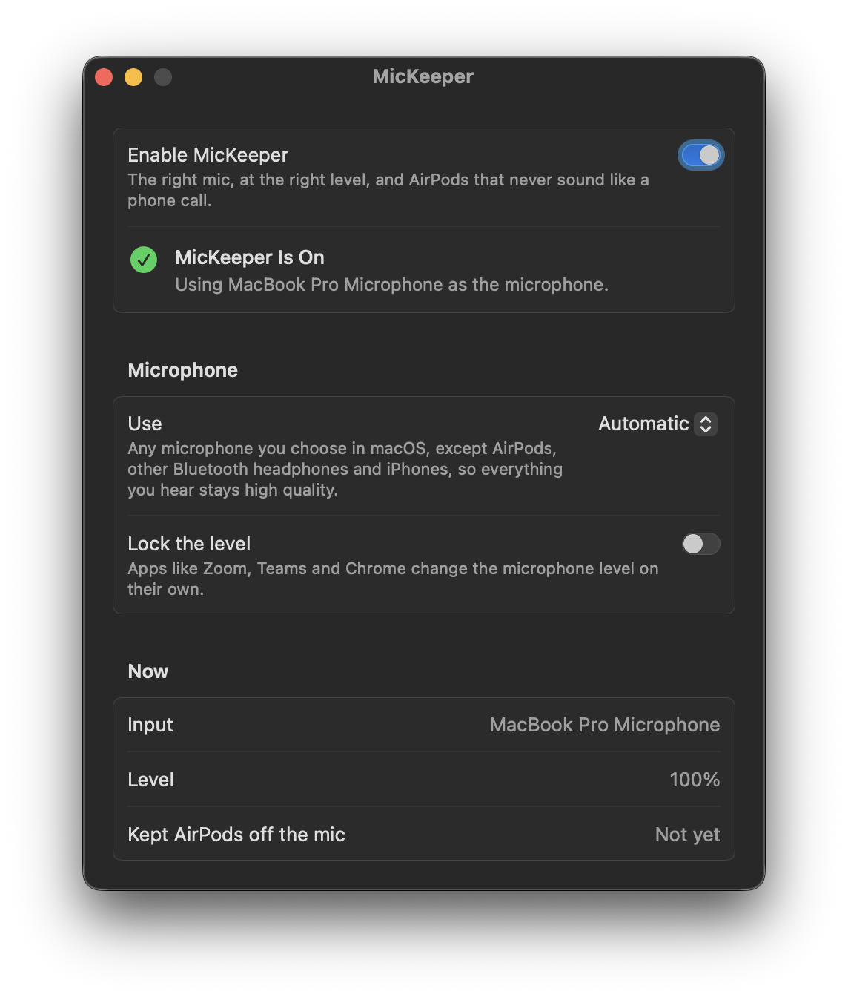

# MicKeeper

**The right mic, at the right level, and AirPods that never sound like a phone call.**

<p align="center">
  
</p>

When AirPods or other Bluetooth headphones connect to a Mac, macOS makes them the microphone too. As soon as an app
uses that microphone (a call, a Meet tab, dictation), the headphones switch to call mode and everything you hear
turns mono and muffled. With an iPhone nearby, macOS may switch to its microphone instead. And apps like Zoom, Teams
and Chrome change your microphone level on their own. MicKeeper keeps all of that in check.

## What it does

- **Keeps AirPods off the microphone.** When macOS switches the input to AirPods or other Bluetooth headphones (when
  they connect, or go back in your ears), MicKeeper switches back to the microphone you were using, or the built-in
  one. Your headphones stay high quality, and their battery lasts longer.
- **Keeps an iPhone off the microphone.** The same when macOS picks a nearby or plugged-in iPhone's microphone. You
  can still use the iPhone as a camera.
- **Or always uses one microphone.** Pick a microphone in the list and MicKeeper uses it whenever it is connected.
  Picking AirPods or an iPhone there is how to use them on purpose.
- **Locks the level.** Optionally puts the microphone level back when an app changes it.
- Shows the current microphone, its level, and how often MicKeeper stepped in.

## Light

- **About 3 MB of memory, no CPU while idle.** Measured over 60 seconds idle with the kernel's own counters: not a
  single instruction run.
- **No polling, no timers.** It sleeps until macOS reports a microphone or level change.
- **Nothing on screen.** No menu bar icon. The settings window runs only while you have it open.
- **No permissions.** MicKeeper never listens to the microphone; it only changes which one is selected, and its
  level.

## Good to know

- Apps that let you pick a microphone themselves (Zoom, Teams, and so on) follow MicKeeper when they are set to the
  system default ("Same as System"). If AirPods are picked inside the app, the app uses them anyway.
- macOS reports your own switch to AirPods in Sound settings exactly like its automatic one, so MicKeeper switches
  back. To use AirPods or an iPhone as the microphone, pick it in MicKeeper.
- To switch between other microphones quickly, hold Option and click the sound icon in the menu bar.

## Requirements

- A Mac with Apple silicon
- macOS 13 Ventura or later

Tested on a 14-inch MacBook Pro (Apple silicon) with macOS 26.7.1 Tahoe, with AirPods Pro and an iPhone.

## Install

### Homebrew

```sh
brew install --cask fratayaydn/tap/mickeeper
```

### Download

Download `MicKeeper-<version>.dmg` from the [latest release](https://github.com/fratayaydn/mickeeper/releases/latest),
open it and drag **MicKeeper** to **Applications**. The app is signed with a Developer ID and notarized by Apple.

### First run

Open **MicKeeper** and turn on **Enable MicKeeper**. It needs no permissions.

The settings window is only for settings: close it and MicKeeper keeps running in the background.

## How it works

- `MicKeeper.app/Contents/MacOS/mickeeperd` is a small background agent, registered as a login item through
  `SMAppService`. It asks CoreAudio to report changes to the default input, the list of devices and the input level,
  and otherwise sleeps.
- When the default input becomes a Bluetooth or Continuity (iPhone) device, it sets it back to the last real
  microphone in use, else the built-in one, else any other real microphone. If there is none, it leaves it alone.
- With a microphone picked in the list, it keeps that one as the default input while it is connected.
- With the level locked, it puts the input level back to the locked value when it changes.
- Only the agent changes the input and its level; the window only saves settings, so the two never race.
- It watches its app bundle through the kernel's event queue (no polling): when the app is replaced by an update it
  restarts with the new version, and when the app is moved to the Trash it removes its login item and quits.
- `MicKeeper.app/Contents/MacOS/MicKeeper` is the SwiftUI settings window. It runs only while open.

MicKeeper uses only public macOS APIs.

## Building from source

Requires the Xcode Command Line Tools (`xcode-select --install`).

```sh
git clone https://github.com/fratayaydn/mickeeper.git
cd mickeeper
make install
```

This builds `MicKeeper.app`, copies it to `/Applications` and opens it. To update, pull and run `make install`
again.

Local builds are signed with a self-signed certificate that `scripts/create-signing-identity.sh` creates on the
first build, so the login item keeps working across rebuilds; `scripts/install.sh` re-registers it after each
update. To sign with your own Apple Developer ID instead:
`make install SIGN_IDENTITY="Developer ID Application: Your Name (TEAMID)"`.

## Uninstall

Move **MicKeeper** from Applications to the Trash (or `brew uninstall --cask mickeeper`). The background agent
notices, removes its login item and quits. If you built it from source, `make uninstall` in the cloned folder also
removes the settings.

## Command line

```sh
/Applications/MicKeeper.app/Contents/MacOS/mickeeperd --status   # prints the current microphone and its level
```

## License

MIT license, see [LICENSE](LICENSE).
